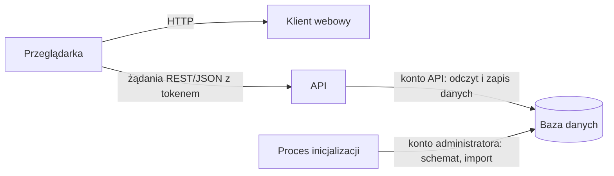
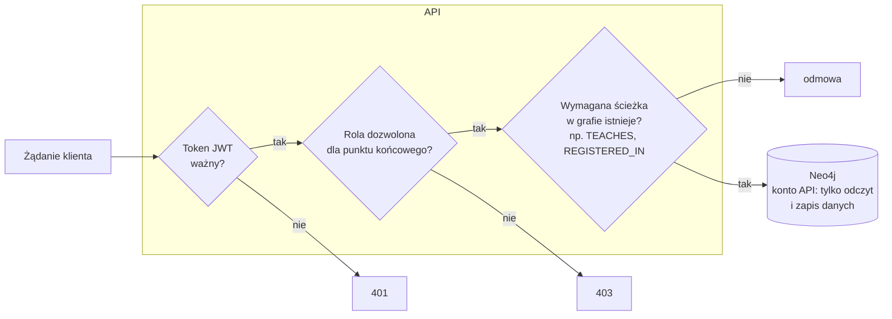

4.1 Architektura systemu

System składa się z trzech warstw: klienta webowego, interfejsu programistycznego aplikacji (API, ang. *Application Programming Interface*) oraz bazy danych. Warstwa API występuje w dwóch wymiennych wariantach: z backendem grafowym, korzystającym z bazy Neo4j, oraz z backendem relacyjnym. Wszystkie warstwy uruchamiane są w osobnych kontenerach, a schemat i dane początkowe bazy wczytuje jednorazowy proces inicjalizacji.


*Elementy systemu i komunikacja między nimi*

Klient webowy jest aplikacją jednostronicową (SPA, ang. *Single-Page Application*), która komunikuje się z systemem wyłącznie przez API. Po zalogowaniu przechowuje token otrzymany od API na czas trwania sesji przeglądarki i dołącza go do każdego żądania. Interfejs jest podzielony na zakładki odpowiadające modułom API: katalog, widok studenta, prowadzącego i administratora.

Użytkownik widzi tylko te zakładki, na które pozwalają role zapisane w tokenie. Ukrywanie zakładek służy jednak wyłącznie wygodzie użytkownika i nie stanowi zabezpieczenia. O dostępie zawsze decyduje backend.

API przyjmuje żądanie, sprawdza poprawność danych wejściowych oraz uprawnienia użytkownika, wykonuje zapytania do bazy danych i zwraca wynik w ustalonym kształcie.

Baza danych przechowuje wszystkie dane systemu i sama pilnuje ich struktury wedle zdefiniowanego schematu.

4.2 Warstwa dostępu do danych

Zgodnie z celem pracy (1.2) model danych zostanie odwzorowany również w postaci relacyjnej, a zapytania obu wariantów porównane pod względem liczby złączeń i czasu wykonania. Dlatego warstwę API zaprojektowano tak, aby baza danych była w niej wymienna. Backend grafowy i relacyjny udostępniają te same punkty końcowe i korzystają z tych samych modeli żądań i odpowiedzi. Klient nie wie, z którym backendem się komunikuje, a każda operacja ma w obu wariantach identyczny kontrakt, więc porównaniu podlega wyłącznie jej realizacja po stronie bazy danych.

Backendy komunikują się z bazą bezpośrednio przez sterownik, wykonując ręcznie napisane zapytania: w języku Cypher dla Neo4j i w języku SQL dla bazy relacyjnej. Zrezygnowano z warstwy mapowania obiektowo-grafowego (OGM, ang. *Object-Graph Mapping*) i obiektowo-relacyjnego (ORM, ang. *Object-Relational Mapping*). Oficjalna biblioteka Neo4j-OGM jest dostępna jedynie dla języka Java [CYTOWANIE: Neo4j-OGM], a dla języka Python istnieje rozwijana w ramach Neo4j Labs biblioteka neomodel [CYTOWANIE: neomodel]. Warstwa mapowania sama generuje zapytania, więc porównanie dotyczyłoby nie modeli danych, lecz tego, jak dwie różne biblioteki tłumaczą te same operacje. Ręcznie pisane zapytania dają ponadto pełną kontrolę nad ich treścią, potrzebną w operacjach, które muszą być odporne na wyścigi (4.3.4).

4.3 Model danych

![[Untitled graph(2).png]]

*Wizualizacja proponowanego modelu bazy danych wykonana przy pomocy arrows.app*

4.3.1 Osoby i użytkownicy

W domenie uczelnianej zdefiniowano następujące etykiety osób: Student dla studentów, Teacher dla prowadzących zajęć oraz Admin dla administratorów i innych osób zarządzających uczelnią. Aby jedna osoba mogła mieć jednocześnie kilka ról (np. prowadzący będący zarazem administratorem), etykiety ról przechowują wyłącznie informacje właściwe dla danej roli. Dane wspólne dla każdej osoby, takie jak imię, nazwisko i numer telefonu, znajdują się we współdzielonej etykiecie Person.

![[Pasted image 20261110202719.png]]

*Przykład osoby z wieloma etykietami: Admin, Student, Teacher, User, Inactive i Person jednocześnie*

![[Pasted image 20261110203022.png]]

*Wizualizacja - podział cech na przynależność do etykiety, gdzie nie każda z etykiet dodaje cechy*

Dane służące do uwierzytelniania (adres e-mail i skrót hasła) przechowywane są w etykiecie User - dopiero ona czyni węzeł osoby pełnoprawnym użytkownikiem, który może zalogować się w portalu i uwierzytelnić w API. Osoba bez etykiety User istnieje w danych (np. jako prowadzący widoczny w katalogu zajęć), ale nie ma dostępu do systemu.

Do tego istnieje etykieta Inactive, która pozwala niedestruktywnie odebrać użytkownikowi dostęp do wszystkich punktów końcowych; przechowuje ona moment dezaktywacji. Bez tej lub podobnej funkcyjnie etykiety odebranie dostępu wymagałoby usunięcia etykiety User wraz z danymi logowania, co powodowałoby utratę danych. Charakter platformy uczelnianej nie zakłada rozbudowanego systemu blokad i kar dla użytkowników - tymczasowe odebranie dostępu wynika raczej z sytuacji takich jak zawieszenie w prawach studenta lub cofnięcie uprawnień do prowadzenia zajęć, dlatego jedna etykieta jest wystarczająca.

Każda z etykiet osób ma zdefiniowane właściwości, z których większość jest wymagana; opcjonalne jest jedynie zdjęcie. Kluczem (wartością niepowtarzalną i zawsze obecną) każdej osoby jest `idx` - numer indeksu lub inny sekwencyjny identyfikator. Dodatkowo kluczem etykiety User jest adres e-mail. Ponadto kombinacja imienia, nazwiska i numeru telefonu musi być unikalna, co zapobiega przypadkowemu wprowadzeniu tej samej osoby dwukrotnie pod różnymi identyfikatorami. Etykieta Admin nie ma własnych właściwości - jej obecność sama w sobie nadaje uprawnienia administracyjne.

| Etykieta | Właściwość | Typ | Wymagana | Ograniczenia | Opis |
|---|---|---|---|---|---|
| Person | `idx` | tekst | tak | klucz | numer indeksu lub inny identyfikator osoby |
| | `name` | tekst | tak | unikalne razem z `surname` i `phone` | imię |
| | `surname` | tekst | tak | (j.w.) | nazwisko |
| | `phone` | tekst | tak | (j.w.) | numer telefonu |
| | `photo` | tekst | nie | – | ścieżka do zdjęcia |
| Student | `joined` | data i czas ze strefą | tak | – | moment rozpoczęcia studiów |
| Teacher | `degree` | tekst | tak | – | stopień lub tytuł naukowy |
| | `working_since` | data | tak | – | data zatrudnienia |
| Admin | – | – | – | – | etykieta bez właściwości, nadaje uprawnienia administracyjne |
| User | `email` | tekst | tak | klucz | login |
| | `passwd_hash` | tekst | tak | – | skrót hasła (bcrypt) |
| Inactive | `deactivated_at` | data i czas ze strefą | tak | – | moment dezaktywacji konta |
*Właściwości etykiet osób*

Aby nie było możliwe utworzenie np. węzła z etykietą Student, który nie ma etykiety Person, wykorzystano mechanizm etykiet implikowanych. Każda z etykiet ról - Student, Teacher i Admin - implikuje etykietę Person, zatem nie da się nadać żadnej z nich bez jednoczesnego nadania etykiety Person i uzupełnienia jej wymaganych właściwości. Tak samo etykiety User i Inactive implikują etykietę Person.

![[Pasted image 20261110203108.png]]

*Przykładowa próba utworzenia węzła z etykietą Student bez właściwości wymaganych przez etykietę Person*

4.3.2 Oferta dydaktyczna

Żeby platforma była użyteczna, muszą się w niej znajdować nie tylko osoby, ale też szeroko pojęta struktura uczelni: wydziały, kierunki, plany studiów, przedmioty i ich realizacje w kolejnych semestrach. Strukturę tę rozbito hierarchicznie na osobne etykiety tak, aby każda informacja była zapisana w jednym miejscu (ang. *single source of truth*). Zapobiega to anomaliom aktualizacji (ang. *update anomalies*), czyli sytuacjom, w których zmiana jednej informacji wymaga poprawienia wielu jej kopii, a pominięcie którejś prowadzi do sprzecznych danych.

Na szczycie hierarchii znajduje się wydział, opisany etykietą Faculty. Ma on identyfikator, nazwę skróconą (np. „W4N”) oraz pełną nazwę (np. „Wydział Informatyki i Telekomunikacji”). W rzeczywistym systemie uczelnianym można by dodać kolejne właściwości, np. opis wydziału czy dane kontaktowe. Na potrzeby prototypu ważniejsze jest jednak to, jak dane łączą się ze sobą, a właściwości można dopisać później w miarę potrzeb.

Wydział prowadzi kierunki studiów (np. „Cyberbezpieczeństwo”), opisane etykietą Programme, z identyfikatorem i unikalną nazwą. Kierunek zawsze należy do jakiegoś wydziału, co wyraża krawędź OFFERED_BY od kierunku do wydziału. **Na potrzeby prototypu nie są rozważane specjalizacje.**

Na każdy kierunek co roku przyjmowani są nowi studenci, a program studiów może się zmieniać między rocznikami. Dlatego od kierunku wychodzą krawędzie HAS_CURRICULUM do planów studiów, opisanych etykietą Curriculum. Plan studiów ma identyfikator oraz rok przyjęcia rocznika, dla którego obowiązuje (`intake_year`, np. „2022/23”). Każdy nowy rocznik na kierunku otrzymuje własny plan studiów.

Plan dzieli się na semestry (np. siedem na studiach inżynierskich). Semestr konkretnego planu, np. „semestr 5 planu Cyberbezpieczeństwa dla rocznika 2022/23”, jest reprezentowany etykietą CurriculumTerm z numerem semestru (`sem`) i połączony z planem krawędzią HAS_TERM. Dzięki temu przedmioty przypisuje się do semestru konkretnej wersji programu, a nie do „piątego semestru Cyberbezpieczeństwa” w ogóle. Zmiana programu dla nowego rocznika nie wpływa więc na roczniki wcześniejsze.

Student nie jest zapisany na kierunek (Programme), tylko na semestr konkretnego planu (CurriculumTerm), krawędzią ENROLLED. Kierunek, plan i wydział studenta wynikają z krawędzi wychodzących od tego semestru. Nowo przyjęci studenci są przypisywani do pierwszego semestru planu swojego rocznika. Przy przejściu na kolejny semestr (np. z piątego na szósty) student otrzymuje nową krawędź ENROLLED, a dotychczasowe pozostają. Krawędzie te tworzą więc historię jego studiów: z każdego zaliczonego semestru można dojść do przedmiotów, które wtedy obowiązywały, i do cyklu, w którym się odbywały. Bieżący semestr nie jest oznaczony osobną właściwością. Jest nim ten, którego cykl akademicki (opisany niżej) obejmuje aktualną datę, dzięki czemu nie trzeba utrzymywać dodatkowej flagi, która mogłaby stać się niespójna z datami cykli. Powtarzanie semestru nie wymaga osobnego mechanizmu: student otrzymuje krawędź do tego samego semestru w planie młodszego rocznika. Student może też być jednocześnie zapisany na semestry dwóch różnych kierunków.

![[Untitled graph(3).png]]
*Wizualizacja hierarchii wydziału, kierunku, planu i semestru wykonana przy pomocy arrows.app*

Plan studiów opisuje kolejność semestrów, ale nie mówi, kiedy dany semestr faktycznie się odbywa. Do tego służy etykieta AcademicCycle, czyli cykl akademicki: rok akademicki (`year`, np. „2025/26”) i semestr zimowy lub letni (`season`: Z lub L), wraz z datami rozpoczęcia i zakończenia. Para rok i semestr jest unikalna, więc każdy cykl istnieje w bazie dokładnie raz. Semestr planu jest połączony z cyklem, w którym się odbywa, krawędzią TAUGHT_IN. Na przykład piąty semestr planu dla rocznika 2022/23 odbywa się w cyklu 2024/25 Z.

Do semestru planu przypisywane są przedmioty, opisane etykietą Subject. Przedmiot jest rozumiany jako szablon, który powtarza się w kolejnych latach: na przykład piąty semestr Cyberbezpieczeństwa w każdym kolejnym planie może zawierać Biometrię. Przedmiot jest identyfikowany unikalnym kodem z katalogu przedmiotów (np. „W04CBE-SI0005G”), ma nazwę i opcjonalną liczbę punktów ECTS. Przypisanie przedmiotu do semestru planu wyraża krawędź INCLUDES. Sama w sobie oznacza ona jedynie, że w danym semestrze przedmiot ma się odbyć. Szczegóły realizacji, takie jak formy zajęć, wagi ocen i grupy, opisują osobne węzły.

Jeśli Subject jest ideą przedmiotu, to jego realizacją w konkretnym cyklu akademickim jest SubjectInstance, np. „Biometria w cyklu 2025/26 Z”. Instancja jest połączona z przedmiotem krawędzią INSTANCE_OF, a z cyklem, w którym się odbywa, krawędzią OFFERED_IN. Przede wszystkim jednak do instancji podpięte są formy zajęć prowadzone w danej edycji przedmiotu (krawędź HAS_TYPE), a przez nie grupy zajęciowe. Dla danego przedmiotu w danym cyklu istnieje co najwyżej jedna instancja, więc jeśli przedmiot znajduje się w planach kilku kierunków odbywających się w tym samym cyklu, wszyscy ich studenci korzystają z tej samej instancji i tych samych grup. Konceptualnie SubjectInstance nie potrzebuje żadnych właściwości, ponieważ jest w pełni wyznaczona przez swoje krawędzie. W schemacie otrzymała jednak identyfikator; powód opisano w rozdziale o implementacji (*todo: numer rozdziału*).

Krawędź INCLUDES prowadzi od semestru planu do przedmiotu, a nie do jego instancji. Plan studiów powstaje z wyprzedzeniem, a instancja dopiero wtedy, gdy przedmiot jest przygotowywany do realizacji w konkretnym cyklu. Semestr zaplanowany na przyszłość nie miałby więc instancji, na którą mógłby wskazywać. Instancję odpowiadającą semestrowi planu można natomiast zawsze wyznaczyć, bo semestr i instancja wskazują na ten sam przedmiot (INCLUDES i INSTANCE_OF) i ten sam cykl (TAUGHT_IN i OFFERED_IN). Bezpośrednia krawędź od semestru planu do instancji powielałaby tę informację i wymagałaby pilnowania, by cykl instancji zgadzał się z cyklem semestru.

Formy zajęć, takie jak wykład, ćwiczenia, laboratorium czy projekt, opisuje etykieta GroupType. Każdy jej węzeł należy do jednej instancji przedmiotu i przechowuje identyfikator, typ zajęć oraz wagę, z jaką ocena z tej formy wchodzi do oceny końcowej z przedmiotu. Wagi form zajęć jednej instancji sumują się do 1, a ocena końcowa jest średnią ważoną ocen z grup, do których student jest zapisany. Ponieważ formy zajęć i wagi należą do instancji, a nie do przedmiotu, zmiana zasad oceniania (np. z 0,7·W + 0,3·L na 0,5·W + 0,3·L + 0,2·P) nie wymaga tworzenia nowego przedmiotu. Wystarczy, że instancja w kolejnym cyklu otrzyma inne formy zajęć, a instancje z poprzednich cykli zachowają swoje zasady.

![[Untitled graph(4).png]]

*Wizualizacja hierarchii semestru, przedmiotu, instancji przedmiotu oraz formy zajęć wykonana w arrows.app*

| Etykieta | Właściwość | Typ | Wymagana | Ograniczenia | Opis |
|---|---|---|---|---|---|
| Faculty | `id` | tekst | tak | klucz | identyfikator wydziału |
| | `name` | tekst | tak | – | nazwa skrócona, np. „W4N” |
| | `full_name` | tekst | tak | – | pełna nazwa wydziału |
| Programme | `id` | tekst | tak | klucz | identyfikator kierunku |
| | `name` | tekst | tak | unikalna | nazwa kierunku |
| Curriculum | `id` | tekst | tak | klucz | identyfikator planu studiów |
| | `intake_year` | tekst | tak | – | rok przyjęcia rocznika, np. „2022/23” |
| CurriculumTerm | `id` | tekst | tak | klucz | identyfikator semestru planu |
| | `sem` | liczba całkowita | tak | – | numer semestru w planie |
| AcademicCycle | `id` | tekst | tak | klucz | identyfikator cyklu |
| | `year` | tekst | tak | unikalny razem z `season` | rok akademicki, np. „2025/26” |
| | `season` | tekst | tak | (j.w.) | semestr: Z (zimowy) lub L (letni) |
| | `start_date` | data | tak | – | początek cyklu |
| | `end_date` | data | tak | – | koniec cyklu |
| Subject | `code` | tekst | tak | klucz | kod przedmiotu z katalogu |
| | `name` | tekst | tak | – | nazwa przedmiotu |
| | `ects` | liczba całkowita | nie | – | liczba punktów ECTS |
| SubjectInstance | `id` | tekst | tak | klucz | identyfikator instancji |
| GroupType | `id` | tekst | tak | klucz | identyfikator formy zajęć |
| | `g_type` | tekst | tak | – | forma zajęć: W, C, L, P… |
| | `weight` | liczba zmiennoprzecinkowa | tak | – | waga w ocenie końcowej |
*Właściwości etykiet oferty dydaktycznej*

Nie wszystkie reguły tej części modelu da się wyrazić typem grafu. Unikalność instancji dla pary przedmiot i cykl, przynależność formy zajęć do dokładnie jednej instancji oraz sumowanie się wag do 1 dotyczą układu krawędzi, a nie pojedynczego węzła, dlatego muszą być pilnowane poza bazą danych (zob. 4.3.7).

4.3.3 Zajęcia

Zajęcia odbywające się na uczelni są podzielone na grupy zajęciowe. Każda grupa należy do jednego typu zajęć (GroupType) jednej instancji przedmiotu, np. „Biometria 2025/26 Z, laboratorium, grupa 3”. Jeśli student chce przejść na kolejny semestr, musi uzyskać pozytywną ocenę ze wszystkich grup zajęciowych, na które się zapisał. **Na potrzeby platformy założono, że każdy przedmiot przypisany do semestru planu studiów jest obowiązkowy.**

Grupy zajęciowe są tym, co rzeczywiście interesuje studenta – wszystkie opisane wcześniej elementy istnieją po to, by te grupy zorganizować. Grupę opisuje etykieta Group. Jej właściwości to identyfikator, numer grupy w obrębie formy zajęć (`number`) oraz limit miejsc (`capacity`). Na potrzeby organizacji zajęć grupa ma też wyznaczony dzień tygodnia (`weekday`), godzinę rozpoczęcia i zakończenia (`start_time`, `end_time`) oraz tygodnie, w których się odbywa (`pnp`): parzyste (P), nieparzyste (NP) albo każdy tydzień (ALL).

Identyfikator nie jest konieczny do wskazania grupy: grupę jednoznacznie wyznacza forma zajęć, do której należy, i jej numer. Ten naturalny klucz obejmuje jednak krawędź (OF_TYPE), a typ grafu pozwala definiować klucze i ograniczenia unikalności wyłącznie na właściwościach jednego węzła. Unikalności numeru grupy w obrębie formy zajęć nie da się więc wymusić w schemacie. Dlatego grupa otrzymała własny identyfikator, który jest kluczem i pozwala odwołać się do niej bezpośrednio, np. przy zapisie na zajęcia lub wystawianiu opinii.

Grupa łączy się z formą zajęć krawędzią OF_TYPE, z salą (Room) krawędzią IN_ROOM, z prowadzącym lub prowadzącymi krawędzią TEACHES, a ze studentami do niej zapisanymi krawędzią REGISTERED_IN. Prowadzi do niej także krawędź OPENS od zapisów, w których jest dostępna (4.3.4), oraz krawędź ABOUT od opinii, które jej dotyczą (4.3.5).

Sala, opisana etykietą Room, jest liściem grafu – łączy się wyłącznie z grupami zajęciowymi. Zawiera nazwę budynku (np. „A1”) oraz numer sali (np. „305”). Para budynek i numer sali jest unikalna. Bardziej znormalizowane byłoby wydzielenie budynków do osobnej etykiety Building, od której wychodziłyby krawędzie do sal. Dodaje to jednak dodatkowy przeskok w każdym zapytaniu o salę, a budynek nie ma w tym systemie żadnych własnych danych ani powiązań, dlatego uznano to za niepotrzebne. Model nie zabrania przypisania dwóch grup do tej samej sali w tym samym czasie – wykrywanie takich kolizji jest regułą, której typ grafu nie wyraża (zob. 4.3.7).

Krawędź REGISTERED_IN pomiędzy studentem a grupą przechowuje moment zapisu (`registered_at`, data i czas ze strefą) oraz ocenę (`grade`), wystawianą później przez prowadzącego w skali od 2,0 do 5,0. Do czasu wystawienia ocena jest pusta. Ocena mogłaby być osobną krawędzią, ale prowadziłaby dokładnie tą samą drogą co REGISTERED_IN, a zapis na grupę i tak jest warunkiem wystawienia oceny. Dlatego zrezygnowano z osobnej krawędzi. Oceny końcowej z przedmiotu nie zapisuje się nigdzie – jest wyznaczana z ocen z grup i wag form zajęć, więc nie może stać się niespójna z ocenami cząstkowymi.

Ograniczeniem takiego rozwiązania jest brak historii: poprawienie oceny nadpisuje poprzednią wartość. Gdyby historia ocen była potrzebna, ocenę należałoby zamienić w osobny węzeł, podobnie jak opinię (4.3.5).

| Etykieta / krawędź | Właściwość | Typ | Wymagana | Ograniczenia | Opis |
|---|---|---|---|---|---|
| Group | `id` | tekst | tak | klucz | identyfikator grupy |
| | `number` | liczba całkowita | tak | – | numer grupy w obrębie formy zajęć |
| | `capacity` | liczba całkowita | tak | – | limit miejsc |
| | `weekday` | liczba całkowita | tak | – | dzień tygodnia |
| | `start_time` | czas ze strefą | tak | – | godzina rozpoczęcia |
| | `end_time` | czas ze strefą | tak | – | godzina zakończenia |
| | `pnp` | tekst | tak | – | tygodnie: P, NP lub ALL |
| Room | `id` | tekst | tak | klucz | identyfikator sali |
| | `building` | tekst | tak | unikalny razem z `room_num` | budynek |
| | `room_num` | tekst | tak | (j.w.) | numer sali |
| REGISTERED_IN | `registered_at` | data i czas ze strefą | tak | – | moment zapisu |
| | `grade` | liczba zmiennoprzecinkowa | nie | – | ocena z grupy |
*Właściwości etykiet i krawędzi związanych z zajęciami*

![[Untitled graph(5).png]]

*Wizualizacja hierarchii przedmiotu, instancji przedmiotu, formy zajęć i grupy zajęciowej przygotowana w arrows.app*

4.3.4 Zapisy na zajęcia

Zapisy na zajęcia odbywają się osobno dla każdego wydziału i każdego cyklu akademickiego. Pojedynczą akcję zapisów, np. „W4N – zapisy 2025/26 Z”, opisuje etykieta Registration. Przechowuje ona identyfikator, nazwę oraz rodzaj zapisów (`reg_type`). Zapisy są połączone z cyklem, którego dotyczą, krawędzią FOR_CYCLE, a z wydziałem, który je organizuje, krawędzią FOR_FACULTY.

Zapisy nie obejmują automatycznie wszystkich grup danego cyklu. Grupy dostępne w danych zapisach wskazuje się jawnie krawędzią OPENS. Dzięki temu ta sama grupa może być dostępna w kilku zapisach, np. w głównych i w późniejszych zapisach korekcyjnych, a grupy, na które studenci nie zapisują się samodzielnie, mogą w ogóle nie być udostępniane.

Zapisy dzieli się na tury, opisane etykietą RegistrationTurn i połączone z zapisami krawędzią HAS_TURN. Tura ma numer (`turn_number`), datę (`date`) oraz godzinę rozpoczęcia i zakończenia (`start_time`, `end_time`). Student jest przydzielany do tury krawędzią ASSIGNED, przy czym w ramach jednych zapisów może należeć do najwyżej jednej tury. Zapisywać się na grupy może tylko w czasie trwania swojej tury i tylko na grupy otwarte w zapisach, do których ta tura należy.

Tura jest osobnym węzłem, a nie właściwością studenta, ponieważ jedna tura obejmuje wielu studentów, a jeden student uczestniczy w wielu zapisach w kolejnych cyklach. Przesunięcie godzin tury jest więc zmianą jednego węzła, a nie danych wszystkich przydzielonych do niej studentów. Z tego samego powodu daty tur nie są zapisane w zapisach (Registration): zapisy mogą mieć dowolną liczbę tur o różnych terminach.

| Etykieta | Właściwość | Typ | Wymagana | Ograniczenia | Opis |
|---|---|---|---|---|---|
| Registration | `id` | tekst | tak | klucz | identyfikator zapisów |
| | `name` | tekst | tak | – | nazwa zapisów |
| | `reg_type` | tekst | tak | – | rodzaj zapisów |
| RegistrationTurn | `id` | tekst | tak | klucz | identyfikator tury |
| | `turn_number` | liczba całkowita | tak | – | numer tury |
| | `date` | data | tak | – | dzień tury |
| | `start_time` | czas ze strefą | tak | – | początek tury |
| | `end_time` | czas ze strefą | tak | – | koniec tury |
*Właściwości etykiet związanych z zapisami*

Sam zapis studenta na grupę jest krawędzią REGISTERED_IN, opisaną w 4.3.3. Zapis jest możliwy, jeśli grupa ma wolne miejsca i student nie jest jeszcze zapisany do innej grupy tej samej formy zajęć tej samej instancji przedmiotu.

Rejestracja na zajęcia jest momentem, w którym setki studentów jednocześnie próbują zapisać się do najlepszej dostępnej grupy. Model i operacje zapisu muszą więc wykluczać wyścigi (ang. *race condition*): nie można dopuścić do sytuacji, w której do grupy zapisano więcej osób, niż wynosi jej limit miejsc. Tak samo nie można pozwolić na zapis do kilku grup tej samej formy zajęć tej samej instancji przedmiotu, na przykład do dwóch grup laboratoryjnych przedmiotu „Bazy danych” w tym samym cyklu. Sposób spełnienia tych wymagań opisano w rozdziale o implementacji.

4.3.5 Opinie

Studenci mogą oceniać zajęcia, w których uczestniczą i prowadzących tych grup. Opinię ją etykieta Opinion. Przechowuje identyfikator, ocenę liczbową (`grade`), opcjonalną treść (`content`) oraz moment wystawienia (`submit`). Opinia jest połączona z trzema węzłami: z autorem krawędzią WRITES (od studenta do opinii), z grupą, której dotyczy krawędzią ABOUT oraz z ocenianym prowadzącym krawędzią ABOUT_TEACHER.

Opinię może wystawić tylko student zapisany do danej grupy i tylko o prowadzącym, który tę grupę prowadzi. Na trójkę student, grupa i prowadzący przypada co najwyżej jedna opinia. Jeśli grupę prowadzi kilka osób, student może ocenić każdą z nich osobno.

| Etykieta | Właściwość | Typ | Wymagana | Ograniczenia | Opis |
|---|---|---|---|---|---|
| Opinion | `id` | tekst | tak | klucz | identyfikator opinii |
| | `grade` | liczba zmiennoprzecinkowa | tak | – | ocena w skali 2,0–5,0 |
| | `content` | tekst | nie | – | treść opinii |
| | `submit` | data i czas ze strefą | tak | – | moment wystawienia |
*Właściwości etykiety Opinion*

Opinia na początku była krawędzią od studenta do grupy, a nauczyciel wynikał pośrednio z tej krawędzi. Po rozważeniu jednak sytuacji, w której jedna grupa jest prowadzona przez kilka osób (np. wykład, na którym prezentacja jest prowadzona prawie za każdym razem przez kogoś innego), zdecydowano się zmienić Opinion na pełnoprawny węzeł. Oficjalna nazwa tego zabiegu to *reifikacja*.

Takie rozwiązanie ma też zalety przy odczycie. Do opinii można dojść od każdej z trzech stron: od studenta (jego opinie), od grupy (opinie o zajęciach) i od prowadzącego (wszystkie opinie o nim, ze wszystkich grup i cykli). Opinia jako węzeł może też w przyszłości otrzymać kolejne powiązania, np. odpowiedź prowadzącego lub zgłoszenie do moderacji.

![[Untitled graph(6).png]]

*Wizualizacja zmiany konwencji wystawiania opinii wykonana w arrows.app*

4.3.6 Krawędzie i kardynalność

W modelu grafowym nie są potrzebne tabele łączące ani klucze obce. Każde powiązanie między węzłami jest krawędzią, niezależnie od tego, czy w modelu relacyjnym byłoby powiązaniem jeden-do-wielu, czy wiele-do-wielu. Kardynalność nadal wynika jednak z domeny (np. grupa zajęciowa odbywa się w jednej sali, a w jednej sali odbywa się wiele grup).

Każda krawędź ma kierunek, nadany zgodnie ze znaczeniem relacji (np. student pisze opinię, a nie opinia studenta). Kierunek nie ogranicza jednak zapytań: po krawędzi można przejść w obie strony z tym samym kosztem, więc wybór kierunku jest decyzją o czytelności modelu, a nie o wydajności.

| Krawędź        | Od              | Do               | Znaczenie                          | Kardynalność | Uwagi                                        |
| -------------- | --------------- | ---------------- | ---------------------------------- | ------------ | -------------------------------------------- |
| OFFERED_BY     | Programme       | Faculty          | kierunek prowadzony przez wydział  | N:1          |                                              |
| HAS_CURRICULUM | Programme       | Curriculum       | plan studiów rocznika na kierunku  | 1:N          |                                              |
| HAS_TERM       | Curriculum      | CurriculumTerm   | semestr planu studiów              | 1:N          |                                              |
| TAUGHT_IN      | CurriculumTerm  | AcademicCycle    | cykl, w którym odbywa się semestr  | N:1          | opcjonalna dla semestrów przyszłych          |
| INCLUDES       | CurriculumTerm  | Subject          | przedmiot w planie semestru        | N:M          |                                              |
| INSTANCE_OF    | SubjectInstance | Subject          | realizacja przedmiotu              | N:1          |                                              |
| OFFERED_IN     | SubjectInstance | AcademicCycle    | cykl realizacji przedmiotu         | N:1          | jedna instancja na parę przedmiot i cykl     |
| HAS_TYPE       | SubjectInstance | GroupType        | forma zajęć instancji              | 1:N          |                                              |
| OF_TYPE        | Group           | GroupType        | forma zajęć grupy                  | N:1          | numer grupy unikalny w obrębie formy         |
| IN_ROOM        | Group           | Room             | sala, w której odbywa się grupa    | N:1          |                                              |
| TEACHES        | Teacher         | Group            | prowadzący grupę                   | N:M          | grupa może mieć kilku prowadzących           |
| WORKS_AT       | Teacher         | Faculty          | zatrudnienie na wydziale           | N:M          |                                              |
| ENROLLED       | Student         | CurriculumTerm   | student na semestrze planu         | N:M          | historia semestrów (4.3.2)                   |
| REGISTERED_IN  | Student         | Group            | zapis na grupę z oceną             | N:M          | najwyżej jedna grupa danej formy zajęć       |
| FOR_CYCLE      | Registration    | AcademicCycle    | cykl, którego dotyczą zapisy       | N:1          |                                              |
| FOR_FACULTY    | Registration    | Faculty          | wydział, którego dotyczą zapisy    | N:1          |                                              |
| HAS_TURN       | Registration    | RegistrationTurn | tura zapisów                       | 1:N          |                                              |
| OPENS          | Registration    | Group            | grupa dostępna w zapisach          | N:M          | grupa może być otwarta w kilku zapisach      |
| ASSIGNED       | Student         | RegistrationTurn | przydział studenta do tury         | N:M          | najwyżej jedna tura w ramach jednych zapisów |
| WRITES         | Student         | Opinion          | autor opinii                       | 1:N          |                                              |
| ABOUT          | Opinion         | Group            | grupa, której dotyczy opinia       | N:1          |                                              |
| ABOUT_TEACHER  | Opinion         | Teacher          | prowadzący, którego dotyczy opinia | N:1          |                                              |
*Typy krawędzi i ich kardynalność wynikająca z domeny*

Wedle konwencji, nazwy krawędzi powinny wyrażać czynności [CYTOWANIE]. Widać jednak, że ta konwencja nie skaluje się dobrze do tak dużej liczby krawędzi, ponieważ gdybym po prostu używał prostych czasowników, takich jak "IS" czy "IN", to bardzo szybko pojawiałyby się one w kilku miejscach w sposób niezamierzony. Jednocześnie, bardziej jednoznaczne nazwy, typu "ABOUT_TEACHER" źle brzmią, gdy rozważy się całe "zdanie" tworzone czytając węzły wraz z krawędziami, na przykład: "(Opinion)-\[ABOUT_TEACHER]->(Teacher)" brzmi niepotrzebnie verbose. O wiele lepiej brzmi "(Opinion)-\[ABOUT]->(Teacher)" lub "(Opinion)-\[IS_ABOUT]->(Teacher)", jednocześnie po samej nazwie krawędzi trudno się domyślić jakich węzłów ona dotyczy.

Wniosek z tego taki, że dla dużych, ustrukturyzowanych baz grafowych, rozwklekłe, długie i jednoznaczne nazwy ułatwiają pisanie kwerend i zrozumienie infrastruktury. Jest to jedynie konwencja nazewnictwa i uwaga na przyszłość. Przepisanie kwerend od nowa, by podążać za tą obserwacją nie zostało uznane za potrzebne.

4.3.7 Ograniczenia schematu

Bazy grafowe domyślnie nie wymuszają schematu, a w tym projekcie dane muszą mieć ściśle określoną strukturę. Dlatego zdefiniowano typ grafu (ang. *graph type*), który wymusza:
- etykiety implikowane (opisane w 4.3.1),
- podanie i istnienie właściwości (`NOT NULL`),
- typy danych właściwości (m.in. tekst, liczby całkowite i zmiennoprzecinkowe, daty, godziny i znaczniki czasu ze strefą czasową),
- klucze i ograniczenia unikalności (również złożone, np. budynek i numer sali, rok i semestr cyklu akademickiego),
- typy węzłów na obu końcach każdego typu krawędzi (np. krawędź TEACHES może prowadzić tylko od prowadzącego do grupy).

Typ grafu nie wymusza natomiast kardynalności krawędzi - nic w bazie nie zabrania podpięcia grupy do dwóch sal. Kardynalność pilnowana jest przez punkty końcowe API, które tworzą krawędzie. Kardynalność można by narzucić po stronie aplikacji za pomocą biblioteki neomodel [CYTOWANIE: https://deepwiki.com/neo4j-contrib/neomodel/2.4-relationships-and-cardinality], która integruje się m.in. z frameworkiem Django. Zrezygnowano z niej z powodów opisanych w 4.2 - zachowania pełnej kontroli nad treścią zapytań i miarodajności porównania z backendem relacyjnym - oraz na rzecz modularnego REST API korzystającego bezpośrednio z drivera Neo4j [CYTOWANIE: https://neo4j.com/docs/api/python-driver/current/].

4.4 Kontrola dostępu

Kontrola dostępu polega na uwierzytelnianiu i autoryzacji: najpierw ustala się, kim jest użytkownik, potem czy może wykonać daną operację. Niezależnie od tego ogranicza się uprawnienia samego API wobec bazy danych.

4.4.1 Uwierzytelnianie

Użytkownik loguje się adresem e-mail i hasłem z etykiety User. Hasła są przechowywane jako skrót wyznaczony algorytmem bcrypt. Jest to funkcja celowo kosztowna obliczeniowo i z wbudowaną solą (ang. *salt*), dzięki czemu nawet wyciek bazy nie pozwala łatwo odtworzyć haseł, a dwóch użytkowników o tym samym haśle ma różne skróty. [CYTOWANIE: https://www.usenix.org/legacy/events/usenix99/provos/provos.pdf]

Logowanie powiedzie się tylko wtedy, gdy istnieje użytkownik o podanym adresie, hasło zgadza się ze skrótem oraz konto nie jest dezaktywowane etykietą Inactive.

Po poprawnym zalogowaniu API wydaje token JWT (ang. *JSON Web Token*) [CYTOWANIE: RFC 7519], podpisany kluczem znanym wyłącznie serwerowi. Token zawiera adres e-mail, identyfikator osoby (`idx`) oraz listę jej ról, a także czas wygaśnięcia. Klient dołącza go do każdego kolejnego żądania w nagłówku `Authorization`. Dzięki temu API jest bezstanowe: nie przechowuje sesji, a do ustalenia tożsamości i ról wystarczy sprawdzić podpis tokenu, bez dodatkowego zapytania do bazy przy każdym żądaniu.

Wybrano JWT, ponieważ jednym z celów pracy jest porównanie wydajności backendu grafowego i relacyjnego. Sprawdzanie tożsamości w bazie przy każdym żądaniu dodawałoby do każdego pomiaru stały narzut, niezwiązany z właściwą operacją, który zaciemniałby różnice między backendami. Przy JWT każde żądanie wykonuje wyłącznie zapytania potrzebne do realizacji samej operacji.

Ceną bezstanowości jest to, że zmiany ról i dezaktywacja konta zaczynają obowiązywać dopiero przy kolejnym logowaniu - wcześniej wydany token pozostaje ważny do wygaśnięcia.

Gdyby ten narzut nie miał znaczenia, można by rozważyć rozwiązanie, w którym token JWT przechowuje jedynie identyfikator osoby i adres e-mail, a role i aktywność konta są sprawdzane na początku każdej kwerendy. Dzięki temu zmiany wchodziłyby w życie od razu. Odczyt etykiety z węzła jest tani [CYTOWANIE], a więc jest to również jak najbardziej poprawne rozwiązanie.

W rzeczywistym wdrożeniu uczelnianym naturalne byłoby oddanie logowania uczelnianemu systemowi pojedynczego logowania (SSO, ang. *Single Sign-On*), co jednak wykracza poza zakres prototypu.

*Chyba przyda sie tutaj jakis obrazek w tym akapicie*

4.4.2 Autoryzacja

Pierwszy etap autoryzacji to kontrola dostępu oparta na rolach (RBAC, ang. *Role-Based Access Control*) [CYTOWANIE]. Każdy punkt końcowy ma z góry określone role, które mogą go wywołać, np. wystawianie ocen jest dostępne dla prowadzących i administratorów, a zapis na grupę - dla studentów. Użytkownik bez wymaganej roli otrzymuje odmowę, zanim żądanie dotrze do bazy danych.

Gdyby polegać jedynie na RBAC, to nie istniałby mechanizm zabraniający prowadzącemu ocenić cudzego studenta w cudzej grupie zajęciowej. Tak samo student mógłby zapisać się do grupy zajęciowej w cudzej turze zapisowej. Sam RBAC nie broni przed taki scenariuszami, ponieważ, wedle ustalonej konwencji, student woła punkty końcowe studenckie, a nauczyciel punkty końcowe nauczycielskie - z poziomu roli problemu nie ma.

Dodatkowy mechanizm blokujący tego typu sytuacje nazywa się kontrolą dostępu opartą na relacjach (ReBAC, ang. *Relationship-Based Access Control*) [CYTOWANIE]. Uprawnienie wynika tu z powiązania między użytkownikiem a zasobem, a nie z samej roli. 

Drugi etap autoryzacji polega więc na sprawdzeniu w bazie, czy odpowiednia ścieżka w grafie istnieje, np. czy od prowadzącego do grupy prowadzi krawędź TEACHES albo czy student jest połączony z grupą krawędzią REGISTERED_IN. Ponownie, w tej platformie krawędzie uprawniające do dostępu są tymi samymi krawędziami, które opisują domenę - nie trzeba utrzymywać osobnych list uprawnień, które mogłyby się rozjechać z danymi. Gdyby przypadkiem dodać prowadzącego do grupy, po czym usunąc powstałą krawędź TEACHES, wraz z nią znikłaby możliwość oceniania studentów w tej grupie przez tego nauczyciela.

Operacje na własnych danych użytkownika, na przykład plan zajęć studenta czy lista jego zapisów, nie przyjmują identyfikatora osoby z treści (ang. *body*) zapytania. Zamiast tego, identyfikator jest brany z tokenu JWT. Dzięki temu student nie może podejrzeć danych innego studenta, podmieniając identyfikator w żądaniu. 

Administrator ma dostęp do wszystkich operacji potrzebnych do zarządzania uczelnią i tworzenia wszystkich niezbędnych krawędzi i węzłów bez potrzeby pisania kwerend w Cypher. Może wykonywać operacje prowadzącego w imieniu dowolnego prowadzącego (np. poprawić ocenę), bez sprawdzania relacji. 

  ```mermaid
  flowchart LR
      TA[Teacher A] -- TEACHES --> G[Group: Biometria L3]
      S[Student] -- REGISTERED_IN --> G
      TB[Teacher B]
      TA -. może ocenić .-> S
      TB -. odmowa .-x S
  ```
*Diagram ilustrujący działanie ReBAC w zasadach wystawiania ocen*

4.4.3 Konto bazodanowe

Kontrola dostępu po stronie API nie chroni przed błędami w samym API ani przed sytuacją, w której ktoś przejmie dane dostępowe, którymi API łączy się z bazą. Dlatego zgodnie z zasadą najmniejszych uprawnień (ang. *principle of least privilege*) [CYTOWANIE] API nie korzysta z konta administratora bazy, tylko z osobnego konta, utworzonego przy inicjalizacji bazy.

Konto to może jedynie odczytywać i zapisywać dane: tworzyć, modyfikować i usuwać węzły, krawędzie i ich właściwości. Nie może natomiast zmieniać typu grafu, ograniczeń ani indeksów, zarządzać użytkownikami i rolami bazy ani administrować serwerem.

Kontu odebrano również możliwość wczytywania danych z zewnątrz bazy. Domyślnie każdy użytkownik Neo4j może wykonać instrukcję `LOAD CSV`, która czyta pliki z katalogu importu na serwerze bazy, a także pobiera dane spod dowolnego adresu URL [CYTOWANIE: dokumentacja Neo4j, LOAD CSV]. API nigdy z niej nie korzysta, więc to uprawnienie służyłoby wyłącznie ewentualnemu atakującemu: po udanym wstrzyknięciu zapytania mógłby on odczytać pliki z serwera albo wysłać żądanie do innych usług w sieci wewnętrznej, w imieniu serwera bazy (ang. *Server-Side Request Forgery*, SSRF).

Zmiany schematu i import danych wykonuje wyłącznie jednorazowy proces inicjalizacji, korzystający z konta administratora.


*Warstwy kontroli dostępu*

4.5 Interfejs API

Klient komunikuje się z backendem przez interfejs REST (ang. *Representational State Transfer*) [CYTOWANIE], wymieniając dane w formacie JSON (ang. *JavaScript Object Notation*) przez protokół HTTP (ang. *Hypertext Transfer Protocol*). Podział interfejsu na moduły oraz sposób zgłaszania odmów wynikają z macierzy uprawnień opisanej w podrozdziale 3.4.

4.5.1 Podział na moduły

Punkty końcowe podzielono na moduły odpowiadające tabelom macierzy uprawnień: funkcje wspólne trafiły do modułu katalogu, funkcje studenta i prowadzącego do osobnych modułów, a funkcje administracyjne do modułu administratora. Dzięki temu wymaganą rolę określa się dla całego modułu, a przy pojedynczych punktach końcowych zapisuje się jedynie wyjątki, np. wystawianie opinii przez administratora w imieniu studenta.

| Moduł | Dostęp | Przeznaczenie |
|---|---|---|
| public | wszyscy | logowanie |
| catalogue | zalogowani | przeglądanie oferty dydaktycznej: przedmiotów, planów studiów, grup, prowadzących i opinii |
| student | Student (opinie także Admin) | semestry, zapisy na zajęcia, oceny, wystawianie opinii |
| teacher | Teacher, Admin | prowadzone grupy, zapisani studenci, wystawianie ocen |
| admin | Admin | tworzenie i modyfikacja danych: osób, kont, ról, oferty dydaktycznej, sal, cykli i zapisów; zapis studenta do grupy z pominięciem tur |
*Moduły interfejsu API*

Moduł katalogu nie jest publiczny, mimo że jest wspólny dla wszystkich ról: wymaga zalogowania, ponieważ zawiera dane osobowe prowadzących i opinie. Opinie zwracane są w nim bez informacji o autorze, ponieważ zgodnie z wymaganiami są anonimowe.

4.5.2 Konwencje

Wszystkie żądania i odpowiedzi są opisane modelami danych, wspólnymi dla obu backendów (4.2). Na ich podstawie API sprawdza poprawność danych wejściowych, zanim wykona jakiekolwiek zapytanie do bazy: brakujące pola, niewłaściwe typy czy wartości spoza dozwolonego zakresu, np. ocena spoza skali 2,0–5,0, są odrzucane z kodem HTTP 422 (ang. *Unprocessable Content*) [CYTOWANIE: RFC 9110], wraz z informacją, które pole jest niepoprawne. Walidacja dotyczy również odpowiedzi - API nie zwróci klientowi danych o innym kształcie, niż zadeklarował.

| Kod | Znaczenie |
|---|---|
| 200 | żądanie obsłużone; ewentualna odmowa wynikająca z reguł domeny w polu `err` |
| 400 | nieoczekiwany błąd wykonania zapytania |
| 401 | brak tokenu albo token nieważny lub wygasły |
| 403 | brak wymaganej roli lub relacji z zasobem (4.4.2) |
| 404 | żądany zasób nie istnieje |
| 422 | dane wejściowe niezgodne z modelem |
*Kody HTTP zwracane przez API*

Odmowy wynikające z reguł domeny, np. brak wolnych miejsc w grupie lub ponowna opinia o tym samym prowadzącym, nie są błędami - zwracane są z kodem 200, a ich przyczynę podaje pole `err` odpowiedzi. Kod 403 oznacza natomiast brak uprawnienia. Wyjątkiem są zapis na grupę i wypis z niej: uprawnienie sprawdzane jest tam w tym samym zapytaniu co zapis (4.3.4), dlatego jego brak również zgłaszany jest w polu `err`.

Punkty końcowe bez parametrów używają metody GET, a pozostałe - metody POST z parametrami w treści żądania. Dzięki temu wszystkie parametry walidowane są w ten sam sposób, a identyfikatory nie trafiają do adresów URL.
