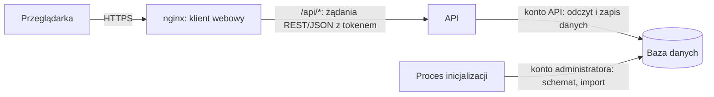
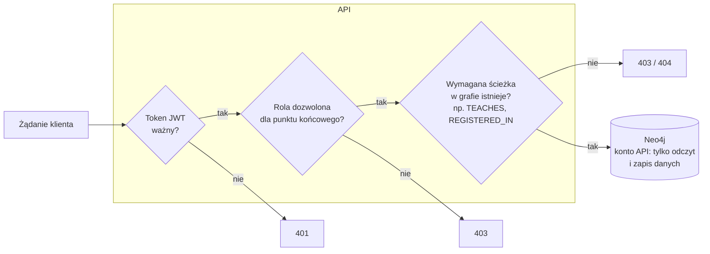

4.1 Architektura systemu

System składa się z trzech warstw: klienta webowego, interfejsu programistycznego aplikacji (API) oraz bazy danych. Warstwa API występuje w dwóch wymiennych wariantach: z backendem grafowym, korzystającym z bazy Neo4j, oraz z backendem relacyjnym. Wszystkie warstwy uruchamiane są w osobnych kontenerach, a schemat i dane początkowe bazy wczytuje jednorazowy proces inicjalizacji.


*Elementy systemu i komunikacja między nimi*

Klient webowy jest aplikacją jednostronicową (SPA, ang. *Single-Page Application*), która komunikuje się z systemem wyłącznie przez API. Po zalogowaniu przechowuje token otrzymany od API na czas trwania sesji przeglądarki i dołącza go do każdego żądania. Interfejs jest podzielony na zakładki odpowiadające modułom API: katalog, widok studenta, prowadzącego i administratora.

Użytkownik widzi tylko te zakładki, na które pozwalają role zapisane w tokenie. Zgodnie z wymaganiami (3.1) nie stanowi to zabezpieczenia – o dostępie zawsze decyduje API.

API przyjmuje żądanie, sprawdza poprawność danych wejściowych oraz uprawnienia użytkownika, wykonuje zapytania do bazy danych i zwraca wynik w ustalonym kształcie.

Baza danych przechowuje wszystkie dane systemu i sama pilnuje ich struktury wedle zdefiniowanego schematu.

4.2 Warstwa dostępu do danych

Model danych zostanie odwzorowany również w postaci relacyjnej, a zapytania obu wariantów porównane pod względem liczby złączeń i czasu wykonania. Dlatego warstwę API zaprojektowano tak, aby baza danych była w niej wymienna. Backend grafowy i relacyjny udostępniają te same punkty końcowe i korzystają z tych samych modeli żądań i odpowiedzi. Klient nie wie, z którym backendem się komunikuje, a każda operacja ma w obu wariantach identyczny kontrakt, więc porównaniu podlega wyłącznie jej realizacja po stronie bazy danych.

Backendy komunikują się z bazą bezpośrednio przez sterownik, wykonując ręcznie napisane zapytania: w języku Cypher dla Neo4j i w języku SQL dla bazy relacyjnej. Zrezygnowano z warstwy mapowania obiektowo-grafowego (OGM, ang. *Object-Graph Mapping*) i obiektowo-relacyjnego (ORM, ang. *Object-Relational Mapping*). Oficjalna biblioteka Neo4j-OGM jest dostępna jedynie dla języka Java [CYTOWANIE: Neo4j-OGM], a dla języka Python istnieje rozwijana w ramach Neo4j Labs biblioteka neomodel [CYTOWANIE: neomodel]. Ponieważ warstwa mapowania generuje zapytania automatycznie, porównanie odzwierciedlałoby sposób ich generowania przez dwie różne biblioteki, utrudniając ocenę samych modeli danych. Ręcznie pisane zapytania dają ponadto pełną kontrolę nad ich treścią.

4.3 Model danych

![[Untitled graph(2).png]]

*Wizualizacja proponowanego modelu bazy danych wykonana przy pomocy arrows.app*

4.3.1 Osoby i użytkownicy

W domenie uczelnianej zdefiniowano następujące etykiety osób: `Student` dla studentów, `Teacher` dla prowadzących zajęć oraz `Admin` dla administratorów i innych osób zarządzających uczelnią. Aby jedna osoba mogła mieć jednocześnie kilka ról (np. prowadzący będący zarazem administratorem), etykiety ról przechowują wyłącznie informacje właściwe dla danej roli. Dane wspólne dla każdej osoby, takie jak imię, nazwisko i numer telefonu, znajdują się we współdzielonej etykiecie `Person`.

![[Pasted image 20261110202719.png]]

*Przykład osoby z wieloma etykietami: `Admin`, `Student`, `Teacher`, `User`, `Inactive` i `Person` jednocześnie*

![[Pasted image 20261110203022.png]]

*Wizualizacja - podział cech na przynależność do etykiety, gdzie nie każda z etykiet dodaje cechy*

Dane służące do uwierzytelniania (adres e-mail i skrót hasła) przechowywane są w etykiecie `User` - dopiero ona czyni węzeł osoby pełnoprawnym użytkownikiem, który może zalogować się w portalu i uwierzytelnić w API. Osoba bez etykiety `User` istnieje w danych (np. jako prowadzący widoczny w katalogu zajęć), ale nie ma dostępu do systemu.

Wymaganie zachowania danych osób, które utraciły dostęp do systemu (3.1), spełnia etykieta `Inactive`. Pozwala ona niedestruktywnie odebrać użytkownikowi dostęp do wszystkich punktów końcowych; przechowuje ona moment dezaktywacji. Bez tej lub podobnej funkcyjnie etykiety odebranie dostępu wymagałoby usunięcia etykiety `User` wraz z danymi logowania. Charakter platformy uczelnianej nie zakłada rozbudowanego systemu blokad i kar dla użytkowników - tymczasowe odebranie dostępu wynika raczej z sytuacji takich jak zawieszenie w prawach studenta lub cofnięcie uprawnień do prowadzenia zajęć, dlatego jedna etykieta jest wystarczająca.

Każda z etykiet osób ma zdefiniowane właściwości, z których większość jest wymagana; opcjonalne jest jedynie zdjęcie. Kluczem (wartością niepowtarzalną i zawsze obecną) każdej osoby jest `idx` - numer indeksu lub inny sekwencyjny identyfikator. Dodatkowo kluczem etykiety `User` jest adres e-mail. Ponadto kombinacja imienia, nazwiska i numeru telefonu musi być unikalna, co zapobiega przypadkowemu wprowadzeniu tej samej osoby dwukrotnie pod różnymi identyfikatorami. Etykieta `Admin` nie ma własnych właściwości.

| Etykieta | Właściwość | Typ | Wymagana | Ograniczenia | Opis |
|---|---|---|---|---|---|
| `Person` | `idx` | tekst | tak | klucz | numer indeksu lub inny identyfikator osoby |
| | `name` | tekst | tak | unikalne razem z `surname` i `phone` | imię |
| | `surname` | tekst | tak | (j.w.) | nazwisko |
| | `phone` | tekst | tak | (j.w.) | numer telefonu |
| | `photo` | tekst | nie | – | ścieżka do zdjęcia |
| `Student` | `joined` | data i czas ze strefą | tak | – | moment rozpoczęcia studiów |
| `Teacher` | `degree` | tekst | tak | – | stopień lub tytuł naukowy |
| | `working_since` | data | tak | – | data zatrudnienia |
| `Admin` | – | – | – | – | etykieta bez właściwości, nadaje uprawnienia administracyjne |
| `User` | `email` | tekst | tak | klucz | login |
| | `passwd_hash` | tekst | tak | – | skrót hasła (bcrypt) |
| `Inactive` | `deactivated_at` | data i czas ze strefą | tak | – | moment dezaktywacji konta |
*Właściwości etykiet osób*

Aby nie było możliwe utworzenie np. węzła z etykietą `Student`, który nie ma etykiety `Person`, wykorzystano mechanizm etykiet implikowanych. Każda z etykiet ról - `Student`, `Teacher` i `Admin` - implikuje etykietę `Person`, zatem nie da się nadać żadnej z nich bez jednoczesnego nadania etykiety `Person` i uzupełnienia jej wymaganych właściwości. Tak samo etykiety `User` i `Inactive` implikują etykietę `Person`.

Z logicznego punktu widzenia etykieta `Inactive` powinna implikować etykietę `User`, ponieważ dezaktywować można wyłącznie konto. Typ grafu na to nie pozwala: etykieta posiadająca własną definicję, taka jak `User`, nie może być jednocześnie etykietą implikowaną (5.3.1). Regułę tę egzekwuje API – dezaktywacja dotyczy wyłącznie węzłów z etykietą `User`, a usunięcie konta zdejmuje etykiety `User` i `Inactive` jednocześnie. Baza danych sama w sobie dopuszcza jednak węzeł z etykietami `Person` i `Inactive` bez etykiety `User`.

![[Pasted image 20261110203108.png]]

*Przykładowa próba utworzenia węzła z etykietą `Student` bez właściwości wymaganych przez etykietę `Person`*

4.3.2 Oferta dydaktyczna

Żeby platforma była użyteczna, muszą się w niej znajdować nie tylko osoby, ale też szeroko pojęta struktura uczelni: wydziały, kierunki, plany studiów, przedmioty i ich realizacje w kolejnych semestrach. Strukturę tę rozbito hierarchicznie na osobne etykiety tak, aby każda informacja była zapisana w jednym miejscu (ang. *single source of truth*). Zapobiega to anomaliom aktualizacji (ang. *update anomalies*), czyli sytuacjom, w których zmiana jednej informacji wymaga poprawienia wielu jej kopii, a pominięcie którejś prowadzi do sprzecznych danych.

Na szczycie hierarchii znajduje się wydział, opisany etykietą `Faculty`. Ma on identyfikator, nazwę skróconą (np. „W4N”) oraz pełną nazwę (np. „Wydział Informatyki i Telekomunikacji”). W rzeczywistym systemie uczelnianym można by dodać kolejne właściwości, np. opis wydziału czy dane kontaktowe. Na potrzeby prototypu ważniejsze jest jednak to, jak dane łączą się ze sobą, a właściwości można dopisać później w miarę potrzeb.

Wydział prowadzi kierunki studiów (np. „Cyberbezpieczeństwo”), opisane etykietą `Programme`, z identyfikatorem i unikalną nazwą. Kierunek zawsze należy do jakiegoś wydziału, co wyraża krawędź `OFFERED_BY` od kierunku do wydziału. **Na potrzeby prototypu nie są rozważane specjalizacje.**

Na każdy kierunek co roku przyjmowani są nowi studenci, a program studiów może się zmieniać między rocznikami. Dlatego od kierunku wychodzą krawędzie `HAS_CURRICULUM` do planów studiów, opisanych etykietą `Curriculum`. Plan studiów ma identyfikator oraz rok przyjęcia rocznika, dla którego obowiązuje (`intake_year`, np. „2022/23”). Każdy nowy rocznik na kierunku otrzymuje własny plan studiów.

Plan dzieli się na semestry (np. siedem na studiach inżynierskich). Semestr konkretnego planu, np. „semestr 5 planu Cyberbezpieczeństwa dla rocznika 2022/23”, jest reprezentowany etykietą `CurriculumTerm` z numerem semestru (`sem`) i połączony z planem krawędzią `HAS_TERM`. Dzięki temu przedmioty są przypisane do semestru konkretnej wersji programu, więc zmiana programu dla nowego rocznika nie wpływa na roczniki wcześniejsze.

Student jest przypisany krawędzią `ENROLLED` bezpośrednio do semestru konkretnego planu (`CurriculumTerm`), z którego wynikają jego kierunek, plan i wydział. Nowo przyjęci studenci są przypisywani do pierwszego semestru planu swojego rocznika. Przy przejściu na kolejny semestr (np. z piątego na szósty) student otrzymuje nową krawędź `ENROLLED`, a dotychczasowe pozostają. Krawędzie te tworzą więc historię jego studiów: z każdego zaliczonego semestru można dojść do przedmiotów, które wtedy obowiązywały, i do cyklu, w którym się odbywały. Bieżący semestr wyznacza się na podstawie dat cyklu akademickiego (opisanego niżej) obejmującego aktualną datę, co eliminuje potrzebę utrzymywania dodatkowej właściwości logicznej mogącej utracić spójność z datami cykli. W przypadku powtarzania semestru student otrzymuje krawędź do odpowiedniego semestru w planie młodszego rocznika. Student może też być jednocześnie zapisany na semestry dwóch różnych kierunków.

![[Untitled graph(3).png]]
*Wizualizacja hierarchii wydziału, kierunku, planu i semestru wykonana przy pomocy arrows.app*

Plan studiów opisuje kolejność semestrów, ale nie mówi, kiedy dany semestr faktycznie się odbywa. Do tego służy etykieta `AcademicCycle`, czyli cykl akademicki: rok akademicki (`year`, np. „2025/26”) i semestr zimowy lub letni (`season`: Z lub L), wraz z datami rozpoczęcia i zakończenia. Para rok i semestr jest unikalna, więc każdy cykl istnieje w bazie dokładnie raz. Semestr planu jest połączony z cyklem, w którym się odbywa, krawędzią `TAUGHT_IN`. Na przykład piąty semestr planu dla rocznika 2022/23 odbywa się w cyklu 2024/25 Z.

Do semestru planu przypisywane są przedmioty, opisane etykietą `Subject`. Przedmiot jest rozumiany jako szablon, który powtarza się w kolejnych latach: na przykład piąty semestr Cyberbezpieczeństwa w każdym kolejnym planie może zawierać Biometrię. Przedmiot jest identyfikowany unikalnym kodem z katalogu przedmiotów (np. „W04CBE-SI0005G”), ma nazwę i opcjonalną liczbę punktów ECTS. Przypisanie przedmiotu do semestru planu wyraża krawędź `INCLUDES`. Sama w sobie oznacza ona jedynie, że w danym semestrze przedmiot ma się odbyć. Szczegóły realizacji, takie jak formy zajęć, wagi ocen i grupy, opisują osobne węzły.

Jeśli `Subject` jest ideą przedmiotu, to jego realizacją w konkretnym cyklu akademickim jest `SubjectInstance`, np. „Biometria w cyklu 2025/26 Z”. Instancja jest połączona z przedmiotem krawędzią `INSTANCE_OF`, a z cyklem, w którym się odbywa, krawędzią `OFFERED_IN`. Przede wszystkim jednak do instancji podpięte są formy zajęć prowadzone w danej edycji przedmiotu (krawędź `HAS_TYPE`), a przez nie grupy zajęciowe. Dla danego przedmiotu w danym cyklu istnieje co najwyżej jedna instancja, więc jeśli przedmiot znajduje się w planach kilku kierunków odbywających się w tym samym cyklu, wszyscy ich studenci korzystają z tej samej instancji i tych samych grup. `SubjectInstance` nie ma żadnych właściwości, ponieważ jest w pełni wyznaczona przez swoje krawędzie – przedmiot i cykl jednoznacznie wskazują instancję. Sposób zapisania takiego węzła w schemacie bazy opisano w rozdziale o implementacji (*todo: numer rozdziału*).

Krawędź `INCLUDES` łączy semestr planu bezpośrednio z przedmiotem. Plan studiów powstaje z wyprzedzeniem, natomiast instancja przedmiotu jest tworzona dopiero podczas przygotowywania realizacji w konkretnym cyklu, więc semestry zaplanowane na przyszłość nie miałyby jeszcze instancji, na którą mogłyby wskazywać. Odpowiadającą semestrowi instancję można zawsze wyznaczyć, ponieważ oba węzły wskazują na ten sam przedmiot (`INCLUDES` i `INSTANCE_OF`) oraz ten sam cykl (`TAUGHT_IN` i `OFFERED_IN`). Bezpośrednia krawędź od semestru planu do instancji powielałaby tę informację i wymagałaby pilnowania zgodności cykli.

Formy zajęć, takie jak wykład, ćwiczenia, laboratorium czy projekt, opisuje etykieta `GroupType`. Każdy jej węzeł należy do jednej instancji przedmiotu i przechowuje identyfikator, typ zajęć oraz wagę, z jaką ocena z tej formy wchodzi do oceny końcowej z przedmiotu. Wagi form zajęć jednej instancji sumują się do 1 i służą do wyznaczenia oceny z przedmiotu w sposób opisany w 3.2. Przypisanie form zajęć i wag do konkretnej instancji sprawia, że zmiana zasad oceniania (np. z 0,7·W + 0,3·L na 0,5·W + 0,3·L + 0,2·P) nie wymaga tworzenia nowego przedmiotu. Wystarczy, że instancja w kolejnym cyklu otrzyma inne formy zajęć, a instancje z poprzednich cykli zachowają swoje zasady.

![[Untitled graph(4).png]]

*Wizualizacja hierarchii semestru, przedmiotu, instancji przedmiotu oraz formy zajęć wykonana w arrows.app*

| Etykieta | Właściwość | Typ | Wymagana | Ograniczenia | Opis |
|---|---|---|---|---|---|
| `Faculty` | `id` | tekst | tak | klucz | identyfikator wydziału |
| | `name` | tekst | tak | – | nazwa skrócona, np. „W4N” |
| | `full_name` | tekst | tak | – | pełna nazwa wydziału |
| `Programme` | `id` | tekst | tak | klucz | identyfikator kierunku |
| | `name` | tekst | tak | unikalna | nazwa kierunku |
| `Curriculum` | `id` | tekst | tak | klucz | identyfikator planu studiów |
| | `intake_year` | tekst | tak | – | rok przyjęcia rocznika, np. „2022/23” |
| `CurriculumTerm` | `id` | tekst | tak | klucz | identyfikator semestru planu |
| | `sem` | liczba całkowita | tak | – | numer semestru w planie |
| `AcademicCycle` | `id` | tekst | tak | klucz | identyfikator cyklu |
| | `year` | tekst | tak | unikalny razem z `season` | rok akademicki, np. „2025/26” |
| | `season` | tekst | tak | (j.w.) | semestr: Z (zimowy) lub L (letni) |
| | `start_date` | data | tak | – | początek cyklu |
| | `end_date` | data | tak | – | koniec cyklu |
| `Subject` | `code` | tekst | tak | klucz | kod przedmiotu z katalogu |
| | `name` | tekst | tak | – | nazwa przedmiotu |
| | `ects` | liczba całkowita | nie | – | liczba punktów ECTS |
| `SubjectInstance` | – | – | – | – | brak właściwości; instancję wyznaczają krawędzie `INSTANCE_OF` i `OFFERED_IN` |
| `GroupType` | `id` | tekst | tak | klucz | identyfikator formy zajęć |
| | `g_type` | tekst | tak | – | forma zajęć: W, C, L, P… |
| | `weight` | liczba zmiennoprzecinkowa | tak | – | waga w ocenie końcowej |
*Właściwości etykiet oferty dydaktycznej*

Nie wszystkie reguły tej części modelu da się wyrazić typem grafu. Unikalność instancji dla pary przedmiot i cykl, przynależność formy zajęć do dokładnie jednej instancji oraz sumowanie się wag do 1 zależą od układu wielu krawędzi, którego typ grafu nie pozwala wyrazić, dlatego muszą być pilnowane poza bazą danych (zob. 4.3.7).

4.3.3 Zajęcia

Zajęcia odbywające się na uczelni są podzielone na grupy zajęciowe. Każda grupa należy do jednego typu zajęć (`GroupType`) jednej instancji przedmiotu, np. „Biometria 2025/26 Z, laboratorium, grupa 3”. Jeśli student chce przejść na kolejny semestr, musi uzyskać pozytywną ocenę ze wszystkich grup zajęciowych, na które się zapisał. **Na potrzeby platformy założono, że każdy przedmiot przypisany do semestru planu studiów jest obowiązkowy.**

Grupę zajęciową opisuje etykieta `Group`. Jej właściwości to identyfikator, numer grupy w obrębie formy zajęć (`number`) oraz limit miejsc (`capacity`). Na potrzeby organizacji zajęć grupa ma też wyznaczony dzień tygodnia (`weekday`), godzinę rozpoczęcia i zakończenia (`start_time`, `end_time`) oraz tygodnie, w których się odbywa (`pnp`): parzyste (P), nieparzyste (NP) albo każdy tydzień (ALL).

Godziny zajęć są zapisane jako czas lokalny, bez przesunięcia strefy czasowej. Zajęcia zaplanowane na 13:15 odbywają się o 13:15 zarówno zimą, jak i latem. Godzina ze stałym przesunięciem (np. 13:15+01:00) po zmianie czasu na letni odpowiadałaby 14:15 czasu polskiego. Przesunięcie jest wyznaczane dopiero wtedy, gdy godzinę łączy się z konkretną datą, w strefie czasowej uczelni (`Europe/Warsaw`). Właściwości opisujące konkretną chwilę, np. moment zapisu czy wystawienia opinii, pozostają datą i czasem ze strefą.

Chociaż grupę jednoznacznie wyznacza jej numer w obrębie formy zajęć, taki klucz naturalny obejmuje krawędź (`OF_TYPE`), a typ grafu pozwala definiować klucze i ograniczenia unikalności wyłącznie na właściwościach pojedynczego węzła. Ponieważ unikalności numeru grupy w obrębie formy zajęć nie da się wymusić w schemacie, grupa otrzymała własny identyfikator będący kluczem i pozwalający odwoływać się do niej bezpośrednio, np. przy zapisie na zajęcia lub wystawianiu opinii.

Grupa łączy się z formą zajęć krawędzią `OF_TYPE`, z salą (`Room`) krawędzią `IN_ROOM`, z prowadzącym lub prowadzącymi krawędzią `TEACHES`, a ze studentami do niej zapisanymi krawędzią `REGISTERED_IN`. Prowadzi do niej także krawędź `OPENS` od zapisów, w których jest dostępna (4.3.4), oraz krawędź `ABOUT` od opinii, które jej dotyczą (4.3.5).

Sala, opisana etykietą `Room`, jest liściem grafu – łączy się wyłącznie z grupami zajęciowymi. Zawiera nazwę budynku (np. „A1”) oraz numer sali (np. „305”). Para budynek i numer sali jest unikalna. Bardziej znormalizowane byłoby wydzielenie budynków do osobnej etykiety `Building`, od której wychodziłyby krawędzie do sal. Dodaje to jednak dodatkowy przeskok w każdym zapytaniu o salę, a budynek nie ma w tym systemie żadnych własnych danych ani powiązań, dlatego uznano to za niepotrzebne. Model nie zabrania przypisania dwóch grup do tej samej sali w tym samym czasie – wykrywanie takich kolizji jest regułą, której typ grafu nie wyraża (zob. 4.3.7).

Krawędź `REGISTERED_IN` pomiędzy studentem a grupą przechowuje moment zapisu (`registered_at`, data i czas ze strefą) oraz ocenę (`grade`), wystawianą później przez prowadzącego (3.2). Do czasu wystawienia ocena jest pusta. Ocena mogłaby być osobną krawędzią, ale prowadziłaby dokładnie tą samą drogą co `REGISTERED_IN`, a zapis na grupę i tak jest warunkiem wystawienia oceny. Dlatego zrezygnowano z osobnej krawędzi. Ocenę końcową z przedmiotu wyznacza się przy odczycie na podstawie ocen z grup i wag form zajęć, dzięki czemu zawsze odpowiada bieżącym ocenom cząstkowym. Średnia ważona obejmuje wyłącznie oceny pozytywne: ocena niższa niż 3.0 z którejkolwiek grupy oznacza ocenę 2.0 z przedmiotu (3.2).

Ograniczeniem takiego rozwiązania jest brak historii: poprawienie oceny nadpisuje poprzednią wartość. Gdyby historia ocen była potrzebna, ocenę należałoby zamienić w osobny węzeł, podobnie jak opinię (4.3.5). Na potrzeby prototypu wystarcza jednak ostatnia wystawiona ocena. Poprawa przedmiotu w kolejnym cyklu tworzy nową krawędź do innej grupy, więc nadpisanie dotyczy jedynie zmiany oceny w obrębie tej samej grupy. W grafie zamiana krawędzi na węzeł jest przy tym tanią refaktoryzacją, którą wskazano jako kierunek dalszego rozwoju.

| Etykieta / krawędź | Właściwość | Typ | Wymagana | Ograniczenia | Opis |
|---|---|---|---|---|---|
| `Group` | `id` | tekst | tak | klucz | identyfikator grupy |
| | `number` | liczba całkowita | tak | – | numer grupy w obrębie formy zajęć |
| | `capacity` | liczba całkowita | tak | – | limit miejsc |
| | `weekday` | liczba całkowita | tak | – | dzień tygodnia |
| | `start_time` | czas lokalny | tak | – | godzina rozpoczęcia |
| | `end_time` | czas lokalny | tak | – | godzina zakończenia |
| | `pnp` | tekst | tak | – | tygodnie: P, NP lub ALL |
| `Room` | `id` | tekst | tak | klucz | identyfikator sali |
| | `building` | tekst | tak | unikalny razem z `room_num` | budynek |
| | `room_num` | tekst | tak | (j.w.) | numer sali |
| `REGISTERED_IN` | `registered_at` | data i czas ze strefą | tak | – | moment zapisu |
| | `grade` | liczba zmiennoprzecinkowa | nie | – | ocena z grupy |
*Właściwości etykiet i krawędzi związanych z zajęciami*

![[Untitled graph(5).png]]

*Wizualizacja hierarchii przedmiotu, instancji przedmiotu, formy zajęć i grupy zajęciowej przygotowana w arrows.app*

4.3.4 Zapisy na zajęcia

Zapisy na zajęcia odbywają się osobno dla każdego wydziału i każdego cyklu akademickiego. Pojedynczą akcję zapisów, np. „W4N – zapisy 2025/26 Z”, opisuje etykieta `Registration`. Przechowuje ona identyfikator, nazwę oraz rodzaj zapisów (`reg_type`). Zapisy są połączone z cyklem, którego dotyczą, krawędzią `FOR_CYCLE`, a z wydziałem, który je organizuje, krawędzią `FOR_FACULTY`.

Grupy dostępne w danych zapisach wskazuje się jawnie krawędzią `OPENS`. Dzięki temu ta sama grupa może być dostępna w kilku zapisach, np. w głównych i w późniejszych zapisach korekcyjnych, a grupy bez samodzielnych zapisów mogą pozostać poza nimi.

Zapisy dzieli się na tury, opisane etykietą `RegistrationTurn` i połączone z zapisami krawędzią `HAS_TURN`. Tura ma numer (`turn_number`), datę (`date`) oraz godzinę rozpoczęcia i zakończenia (`start_time`, `end_time`), zapisaną jako czas lokalny, podobnie jak godziny zajęć (4.3.3). Student jest przydzielany do tury krawędzią `ASSIGNED`, przy czym w ramach jednych zapisów może należeć do najwyżej jednej tury. Zapisywać się na grupy może tylko w czasie trwania swojej tury i tylko na grupy otwarte w zapisach, do których ta tura należy.

Wydzielenie tury jako osobnego węzła pozwala przypisywać zapisom dowolną liczbę tur o różnych terminach, a ponieważ jedna tura obejmuje wielu studentów, przesunięcie jej godzin wymaga zmiany tylko jednego węzła.

| Etykieta           | Właściwość    | Typ              | Wymagana | Ograniczenia | Opis                  |
| ------------------ | ------------- | ---------------- | -------- | ------------ | --------------------- |
| `Registration`     | `id`          | tekst            | tak      | klucz        | identyfikator zapisów |
|                    | `name`        | tekst            | tak      | –            | nazwa zapisów         |
|                    | `reg_type`    | tekst            | tak      | –            | rodzaj zapisów        |
| `RegistrationTurn` | `id`          | tekst            | tak      | klucz        | identyfikator tury    |
|                    | `turn_number` | liczba całkowita | tak      | –            | numer tury            |
|                    | `date`        | data             | tak      | –            | dzień tury            |
|                    | `start_time`  | czas lokalny     | tak      | –            | początek tury         |
|                    | `end_time`    | czas lokalny     | tak      | –            | koniec tury           |
*Właściwości etykiet związanych z zapisami*

Sam zapis studenta na grupę jest krawędzią `REGISTERED_IN`, opisaną w 4.3.3. Warunki zapisu – limit miejsc i najwyżej jedna grupa danej formy zajęć w ramach instancji przedmiotu – oraz odporność na wyścigi przy jednoczesnych zapisach wynikają z wymagań (3.2, 3.3) i są egzekwowane przez operacje zapisu w warstwie API, opisane w 5.5.10.

4.3.5 Opinie

Studenci mogą oceniać zajęcia, w których uczestniczą i prowadzących tych grup. Opinię opisuje etykieta `Opinion`. Przechowuje identyfikator, ocenę liczbową (`grade`), opcjonalną treść (`content`) oraz moment wystawienia (`submit`). Opinia jest połączona z trzema węzłami: z autorem krawędzią `WRITES` (od studenta do opinii), z grupą, której dotyczy krawędzią `ABOUT` oraz z ocenianym prowadzącym krawędzią `ABOUT_TEACHER`.

Reguły wystawiania opinii określono w 3.4 i 3.5. Ponieważ opinia dotyczy pary grupa i prowadzący, a grupę może prowadzić kilka osób, student może ocenić każdą z nich osobno.

Krawędź `WRITES` jest potrzebna do egzekwowania reguły jednej opinii na parę grupa i prowadzący, dlatego autor opinii pozostaje zapisany w grafie. Inni użytkownicy go nie widzą, ale system może go ustalić. Opinie są więc pseudonimowe. Pełna anonimizacja wymagałaby usunięcia powiązania z autorem, co uniemożliwiłoby wykrywanie powtórzonych opinii.

| Etykieta | Właściwość | Typ | Wymagana | Ograniczenia | Opis                  |
| --------- | ---------- | ------------------------- | -------- | ------------ | --------------------- |
| `Opinion` | `id` | tekst | tak | klucz | identyfikator opinii  |
| | `grade` | liczba zmiennoprzecinkowa | tak | – | ocena w skali 2.0–5.0 |
| | `content` | tekst | nie | – | treść opinii          |
| | `submit` | data i czas ze strefą | tak | – | moment wystawienia    |
*Właściwości etykiety `Opinion`*

Opinia na początku była krawędzią od studenta do grupy, a nauczyciel wynikał pośrednio z tej krawędzi. Po rozważeniu jednak sytuacji, w której jedna grupa jest prowadzona przez kilka osób (np. wykład, na którym prezentacja jest prowadzona prawie za każdym razem przez kogoś innego), zdecydowano się zmienić `Opinion` na pełnoprawny węzeł. Oficjalna nazwa tego zabiegu to *reifikacja*.

Takie rozwiązanie ma też zalety przy odczycie. Do opinii można dojść od każdej z trzech stron: od studenta (jego opinie), od grupy (opinie o zajęciach) i od prowadzącego (wszystkie opinie o nim, ze wszystkich grup i cykli). Opinia jako węzeł może też w przyszłości otrzymać kolejne powiązania, np. odpowiedź prowadzącego lub zgłoszenie do moderacji.

![[Untitled graph(6).png]]

*Wizualizacja zmiany konwencji wystawiania opinii wykonana w arrows.app*

4.3.6 Krawędzie i kardynalność

W modelu grafowym nie są potrzebne tabele łączące ani klucze obce. Każde powiązanie między węzłami jest krawędzią, niezależnie od tego, czy w modelu relacyjnym byłoby powiązaniem jeden-do-wielu, czy wiele-do-wielu. Kardynalność nadal wynika jednak z domeny (np. grupa zajęciowa odbywa się w jednej sali, a w jednej sali odbywa się wiele grup).

Każda krawędź ma kierunek nadany zgodnie ze znaczeniem relacji (np. od studenta do opinii). Kierunek nie ogranicza jednak zapytań: po krawędzi można przejść w obie strony z tym samym kosztem, więc jego dobór wpływa jedynie na czytelność modelu.

| Krawędź        | Od              | Do               | Znaczenie                          | Kardynalność | Uwagi                                        |
| -------------- | --------------- | ---------------- | ---------------------------------- | ------------ | -------------------------------------------- |
| `OFFERED_BY`     | `Programme`       | `Faculty`          | kierunek prowadzony przez wydział  | N:1          |                                              |
| `HAS_CURRICULUM` | `Programme`       | `Curriculum`       | plan studiów rocznika na kierunku  | 1:N          |                                              |
| `HAS_TERM`       | `Curriculum`      | `CurriculumTerm`   | semestr planu studiów              | 1:N          |                                              |
| `TAUGHT_IN`      | `CurriculumTerm`  | `AcademicCycle`    | cykl, w którym odbywa się semestr  | N:1          | opcjonalna dla semestrów przyszłych          |
| `INCLUDES`       | `CurriculumTerm`  | `Subject`          | przedmiot w planie semestru        | N:M          |                                              |
| `INSTANCE_OF`    | `SubjectInstance` | `Subject`          | realizacja przedmiotu              | N:1          |                                              |
| `OFFERED_IN`     | `SubjectInstance` | `AcademicCycle`    | cykl realizacji przedmiotu         | N:1          | jedna instancja na parę przedmiot i cykl     |
| `HAS_TYPE`       | `SubjectInstance` | `GroupType`        | forma zajęć instancji              | 1:N          |                                              |
| `OF_TYPE`        | `Group`           | `GroupType`        | forma zajęć grupy                  | N:1          | numer grupy unikalny w obrębie formy         |
| `IN_ROOM`        | `Group`           | `Room`             | sala, w której odbywa się grupa    | N:1          |                                              |
| `TEACHES`        | `Teacher`         | `Group`            | prowadzący grupę                   | N:M          | grupa może mieć kilku prowadzących           |
| `WORKS_AT`       | `Teacher`         | `Faculty`          | zatrudnienie na wydziale           | N:M          |                                              |
| `ENROLLED`       | `Student`         | `CurriculumTerm`   | student na semestrze planu         | N:M          | historia semestrów (4.3.2)                   |
| `REGISTERED_IN`  | `Student`         | `Group`            | zapis na grupę z oceną             | N:M          | najwyżej jedna grupa danej formy zajęć       |
| `FOR_CYCLE`      | `Registration`    | `AcademicCycle`    | cykl, którego dotyczą zapisy       | N:1          |                                              |
| `FOR_FACULTY`    | `Registration`    | `Faculty`          | wydział, którego dotyczą zapisy    | N:1          |                                              |
| `HAS_TURN`       | `Registration`    | `RegistrationTurn` | tura zapisów                       | 1:N          |                                              |
| `OPENS`          | `Registration`    | `Group`            | grupa dostępna w zapisach          | N:M          | grupa może być otwarta w kilku zapisach      |
| `ASSIGNED`       | `Student`         | `RegistrationTurn` | przydział studenta do tury         | N:M          | najwyżej jedna tura w ramach jednych zapisów |
| `WRITES`         | `Student`         | `Opinion`          | autor opinii                       | 1:N          |                                              |
| `ABOUT`          | `Opinion`         | `Group`            | grupa, której dotyczy opinia       | N:1          |                                              |
| `ABOUT_TEACHER`  | `Opinion`         | `Teacher`          | prowadzący, którego dotyczy opinia | N:1          |                                              |
*Typy krawędzi i ich kardynalność wynikająca z domeny*

Wedle konwencji, nazwy krawędzi powinny wyrażać czynności [CYTOWANIE]. Widać jednak, że ta konwencja nie skaluje się dobrze do tak dużej liczby krawędzi, ponieważ gdyby po prostu używać prostych czasowników, takich jak "`IS`" czy "`IN`", to bardzo szybko pojawiałyby się one w kilku miejscach w sposób niezamierzony. Jednocześnie, bardziej jednoznaczne nazwy, typu "`ABOUT_TEACHER`" źle brzmią, gdy rozważy się całe "zdanie" tworzone czytając węzły wraz z krawędziami, na przykład: "`(Opinion)-[ABOUT_TEACHER]->(Teacher)`" brzmi niepotrzebnie rozwlekle (ang. *verbose*). O wiele lepiej brzmi "`(Opinion)-[ABOUT]->(Teacher)`" lub "`(Opinion)-[IS_ABOUT]->(Teacher)`", jednocześnie po samej nazwie krawędzi trudno się domyślić jakich węzłów ona dotyczy.

Wniosek z tego taki, że dla dużych, ustrukturyzowanych baz grafowych, rozwlekłe, długie i jednoznaczne nazwy ułatwiają pisanie kwerend i zrozumienie infrastruktury. Jest to jedynie konwencja nazewnictwa i uwaga na przyszłość. Przepisania kwerend od nowa w celu dostosowania do tej obserwacji nie uznano za konieczne.

4.3.7 Ograniczenia schematu

Bazy grafowe domyślnie nie wymuszają schematu, a w tym projekcie dane muszą mieć ściśle określoną strukturę. Dlatego zdefiniowano typ grafu (ang. *graph type*), który wymusza:
- etykiety implikowane (opisane w 4.3.1),
- podanie i istnienie właściwości (`NOT NULL`),
- typy danych właściwości (m.in. tekst, liczby całkowite i zmiennoprzecinkowe, daty, godziny lokalne i znaczniki czasu ze strefą czasową),
- klucze i ograniczenia unikalności (również złożone, np. budynek i numer sali, rok i semestr cyklu akademickiego),
- typy węzłów na obu końcach każdego typu krawędzi (np. krawędź `TEACHES` może prowadzić tylko od prowadzącego do grupy).

Typ grafu nie wymusza natomiast kardynalności krawędzi - nic w bazie nie zabrania podpięcia grupy do dwóch sal. Kardynalność pilnowana jest przez punkty końcowe API, które tworzą krawędzie. Kardynalność można by narzucić po stronie aplikacji za pomocą biblioteki neomodel [CYTOWANIE: https://deepwiki.com/neo4j-contrib/neomodel/2.4-relationships-and-cardinality], która integruje się m.in. z frameworkiem Django. Zrezygnowano z niej z powodów opisanych w 4.2 - zachowania pełnej kontroli nad treścią zapytań i miarodajności porównania z backendem relacyjnym - oraz na rzecz modularnego API w stylu REST (ang. *Representational State Transfer*) korzystającego bezpośrednio ze sterownika Neo4j [CYTOWANIE: https://neo4j.com/docs/api/python-driver/current/].

4.4 Kontrola dostępu

Kontrola dostępu polega na uwierzytelnianiu i autoryzacji: najpierw ustala się, kim jest użytkownik, potem czy może wykonać daną operację. Niezależnie od tego ogranicza się uprawnienia samego API wobec bazy danych.

4.4.1 Uwierzytelnianie

Użytkownik loguje się adresem e-mail i hasłem z etykiety `User`. Zgodnie z wymaganiami (3.3) hasła są przechowywane jako skrót z solą, wyznaczony algorytmem bcrypt. Jest to funkcja celowo kosztowna obliczeniowo i z wbudowaną solą (ang. *salt*), dzięki czemu nawet wyciek bazy nie pozwala łatwo odtworzyć haseł, a dwóch użytkowników o tym samym haśle ma różne skróty. [CYTOWANIE: https://www.usenix.org/legacy/events/usenix99/provos/provos.pdf]

Logowanie powiedzie się tylko wtedy, gdy:
- istnieje użytkownik o podanym adresie,
- hasło zgadza się ze skrótem,
- konto nie jest dezaktywowane etykietą `Inactive`,
- osoba ma co najmniej jedną rolę (`Student`, `Teacher` lub `Admin`) - bez niej token nie dawałby dostępu do żadnego modułu API.

Błędny adres i błędne hasło dają tę samą odpowiedź (401). Komunikat jest ten sam, żeby nie zdradzać, czy konto o danym adresie istnieje. Konto nieaktywne lub bez roli jest odrzucane z kodem 403.

Po poprawnym zalogowaniu API wydaje token JWT (ang. *JSON Web Token*) [CYTOWANIE: RFC 7519], podpisany kluczem znanym wyłącznie serwerowi. Token zawiera adres e-mail, identyfikator osoby (`idx`) oraz listę jej ról, a także czas wygaśnięcia. Klient dołącza go do każdego kolejnego żądania w nagłówku `Authorization`. Dzięki temu API jest bezstanowe: nie przechowuje sesji, a do ustalenia tożsamości i ról wystarczy sprawdzić podpis tokenu.

Wybrano JWT, ponieważ jednym z celów pracy jest porównanie wydajności backendu grafowego i relacyjnego. Sprawdzanie tożsamości w bazie przy każdym żądaniu dodawałoby do każdego pomiaru stały narzut, niezwiązany z właściwą operacją, który zaciemniałby różnice między backendami. Przy JWT każde żądanie wykonuje wyłącznie zapytania potrzebne do realizacji samej operacji.

Ceną bezstanowości jest to, że token zawiera role z chwili logowania i pozostaje ważny do wygaśnięcia, nawet jeśli w międzyczasie zmieniono role osoby lub dezaktywowano jej konto. W przypadku ról studenta i prowadzącego skutki są ograniczone. Kwerendy tych modułów zaczynają się od węzła osoby z etykietą roli, np. `(st:Student {idx: ...})`, więc po odebraniu etykiety nie dopasowują niczego i żądanie zostaje odrzucone. Funkcje administracyjne nie przechodzą po żadnej ścieżce zaczynającej się od administratora. Bez dodatkowego mechanizmu odebranie roli `Admin` zaczęłoby więc obowiązywać dopiero po wygaśnięciu tokenu, czyli nawet po 12 godzinach.

Z tego powodu API samo unieważnia tokeny, bez odczytu z bazy danych. Token zawiera moment wydania, a API przechowuje w pamięci moment ostatniej zmiany uprawnień każdej osoby: odebrania roli, dezaktywacji lub usunięcia konta. Tokeny wydane przed tym momentem są odrzucane, więc osoba musi zalogować się ponownie i otrzymuje token z aktualnymi rolami. Lista unieważnień znika przy ponownym uruchomieniu API. Dlatego odrzucane są również wszystkie tokeny wydane przed startem procesu, a restart wylogowuje wszystkich użytkowników. Rozwiązanie zakłada działanie jednego procesu API, co w prototypie jest spełnione.

Alternatywą byłoby przechowywanie w tokenie jedynie identyfikatora osoby i adresu e-mail oraz sprawdzanie ról i aktywności konta na początku każdej kwerendy. Odczyt etykiety z węzła jest tani [CYTOWANIE], jednak dodawałby zapytanie do każdego żądania, a więc stały narzut do pomiarów porównujących oba backendy.

W rzeczywistym wdrożeniu uczelnianym naturalne byłoby oddanie logowania uczelnianemu systemowi pojedynczego logowania (SSO, ang. *Single Sign-On*), co jednak wykracza poza zakres prototypu.

*Chyba przyda sie tutaj jakis obrazek w tym akapicie*

4.4.2 Autoryzacja

Model uprawnień z podrozdziału 3.4 łączy role użytkownika z jego powiązaniami z innymi elementami uczelni. Odpowiadają temu dwa etapy autoryzacji. Pierwszy z nich to kontrola dostępu oparta na rolach (RBAC) [CYTOWANIE]. Każdy punkt końcowy ma z góry określone role, które mogą go wywołać, np. wystawianie ocen jest dostępne dla prowadzących i administratorów, a zapis na grupę - dla studentów. Użytkownik bez wymaganej roli otrzymuje odmowę, zanim żądanie dotrze do bazy danych.

Gdyby polegać jedynie na RBAC, to nie istniałby mechanizm zabraniający prowadzącemu ocenić cudzego studenta w cudzej grupie zajęciowej. Tak samo student mógłby zapisać się do grupy zajęciowej w cudzej turze zapisowej. Sam RBAC nie broni przed takimi scenariuszami, ponieważ, wedle ustalonej konwencji, student woła punkty końcowe studenckie, a nauczyciel punkty końcowe nauczycielskie - z poziomu roli problemu nie ma.

Dodatkowy mechanizm blokujący tego typu sytuacje nazywa się kontrolą dostępu opartą na relacjach (ReBAC) [CYTOWANIE]. Uprawnienie wynika tu dodatkowo z powiązania między użytkownikiem a zasobem w strukturze danych. 

Drugi etap autoryzacji polega więc na sprawdzeniu w bazie, czy odpowiednia ścieżka w grafie istnieje, np. czy od prowadzącego do grupy prowadzi krawędź `TEACHES` albo czy student jest połączony z grupą krawędzią `REGISTERED_IN`. Ponownie, w tej platformie krawędzie uprawniające do dostępu są tymi samymi krawędziami, które opisują domenę - nie trzeba utrzymywać osobnych list uprawnień, które mogłyby utracić spójność z danymi. Gdyby przypadkiem dodać prowadzącego do grupy, po czym usunąć powstałą krawędź `TEACHES`, wraz z nią znikłaby możliwość oceniania studentów w tej grupie przez tego nauczyciela.

W operacjach na własnych danych użytkownika, takich jak plan zajęć studenta czy lista jego zapisów, identyfikator osoby pobierany jest bezpośrednio z tokenu JWT. Dzięki temu student nie może podejrzeć danych innego studenta, podmieniając identyfikator w żądaniu. Takie operacje mają w ścieżce prefiks `/me/` (np. `GET /me/enrolments`), bez identyfikatora osoby w ścieżce ani w treści (ang. *body*) żądania.

Administrator, zgodnie z macierzą uprawnień (3.4), może wykonywać operacje prowadzącego w imieniu dowolnego prowadzącego (np. poprawić ocenę), bez sprawdzania relacji. 

  ```mermaid
  flowchart LR
      TA[Teacher A] -- TEACHES --> G[Group: Biometria L3]
      S[Student] -- REGISTERED_IN --> G
      TB[Teacher B]
      TA -. może ocenić .-> S
      TB -. odmowa .-x S
  ```
*Diagram ilustrujący działanie ReBAC w zasadach wystawiania ocen*

4.4.3 Konto bazodanowe

Kontrola dostępu po stronie API nie chroni przed błędami w samym API ani przed sytuacją, w której ktoś przejmie dane dostępowe, którymi API łączy się z bazą. Dlatego zgodnie z zasadą najmniejszych uprawnień (3.3) [CYTOWANIE] API łączy się z bazą za pomocą osobnego konta utworzonego podczas inicjalizacji, z uprawnieniami ograniczonymi do odczytu i zapisu danych.

Konto to pozwala tworzyć, modyfikować i usuwać węzły, krawędzie oraz ich właściwości, bez prawa do zmiany typu grafu, ograniczeń i indeksów, zarządzania użytkownikami i rolami bazy czy administracji serwerem.

Kontu odebrano również możliwość wczytywania danych z zewnątrz bazy. Domyślnie każdy użytkownik Neo4j może wykonać instrukcję `LOAD CSV`, która czyta pliki z katalogu importu na serwerze bazy, a także pobiera dane spod dowolnego adresu URL (ang. *Uniform Resource Locator*) [CYTOWANIE: dokumentacja Neo4j, LOAD CSV]. API nigdy z niej nie korzysta, więc to uprawnienie służyłoby wyłącznie ewentualnemu atakującemu: po udanym wstrzyknięciu zapytania mógłby on odczytać pliki z serwera albo wysłać żądanie do innych usług w sieci wewnętrznej, w imieniu serwera bazy (SSRF, ang. *Server-Side Request Forgery*).

Zmiany schematu i import danych wykonuje wyłącznie jednorazowy proces inicjalizacji, korzystający z konta administratora.


*Warstwy kontroli dostępu*

4.5 Interfejs API

Klient komunikuje się z backendem przez interfejs REST [CYTOWANIE], wymieniając dane w formacie JSON (ang. *JavaScript Object Notation*) przez protokół HTTP (ang. *Hypertext Transfer Protocol*). Podział interfejsu na moduły oraz sposób zgłaszania odmów wynikają z macierzy uprawnień opisanej w podrozdziale 3.4.

4.5.1 Podział na moduły

Punkty końcowe podzielono na moduły odpowiadające tabelom macierzy uprawnień: funkcje wspólne trafiły do modułu katalogu, funkcje studenta i prowadzącego do osobnych modułów, a funkcje administracyjne do modułu administratora. Dzięki temu wymaganą rolę określa się dla całego modułu, a przy pojedynczych punktach końcowych zapisuje się jedynie wyjątki, np. lista własnych grup prowadzącego, niedostępna dla administratora, który nie prowadzi zajęć.

| Moduł | Dostęp | Przeznaczenie |
|---|---|---|
| public | wszyscy | logowanie |
| catalogue | zalogowani | przeglądanie oferty dydaktycznej: przedmiotów, planów studiów, grup, prowadzących i opinii |
| student | `Student` | semestry, zapisy na zajęcia, oceny, wystawianie opinii |
| teacher | `Teacher`, `Admin` | prowadzone grupy, zapisani studenci, wystawianie ocen |
| admin | `Admin` | tworzenie i modyfikacja danych: osób, kont, ról, oferty dydaktycznej, sal, cykli i zapisów; zapis studenta do grupy z pominięciem tur |
*Moduły interfejsu API*

Moduł katalogu nie jest publiczny, mimo że jest wspólny dla wszystkich ról: wymaga zalogowania, ponieważ zawiera dane osobowe prowadzących i opinie. Opinie zwracane są w nim bez informacji o autorze (3.4) i z samą datą wystawienia. Dokładny czas wystawienia w połączeniu z listą studentów grupy pozwalałby prowadzącemu typować autora opinii w małych grupach.

4.5.2 Konwencje

Wszystkie żądania i odpowiedzi są opisane modelami danych, wspólnymi dla obu backendów (4.2). Na ich podstawie API sprawdza poprawność danych wejściowych, zanim wykona jakiekolwiek zapytanie do bazy: brakujące pola, niewłaściwe typy czy wartości spoza dozwolonego zakresu, np. ocena spoza skali 2.0–5.0, są odrzucane z kodem HTTP 422 (ang. *Unprocessable Content*) [CYTOWANIE: RFC 9110], wraz z informacją, które pole jest niepoprawne. Walidacja dotyczy również odpowiedzi - API nie zwróci klientowi danych o innym kształcie, niż zadeklarował.

Wynik operacji przekazuje kod odpowiedzi HTTP [CYTOWANIE: RFC 9110, sekcja 15]. Sukces oznacza kod 200, utworzenie zasobu kod 201 wraz z nagłówkiem `Location` wskazującym nowy zasób, a pomyślna operacja bez treści odpowiedzi kod 204. Błędy mają zawsze postać `{"detail": "<komunikat>"}`, a ich rodzaj określa kod:

| Kod | Znaczenie                                                                     |
| --- | ----------------------------------------------------------------------------- |
| 400 | baza danych odrzuciła parametr zapytania, np. niepoprawną datę                |
| 401 | brak lub nieważny token, błędny e-mail lub hasło                              |
| 403 | rola lub relacje użytkownika nie pozwalają na operację                        |
| 404 | zasób wskazany w ścieżce lub treści żądania nie istnieje                      |
| 409 | konflikt z bieżącym stanem danych, np. duplikat, pełna grupa, ostatnia rola   |
| 422 | niepoprawne wartości, np. zły format lub data końca wcześniejsza niż początek |
| 500 | nieoczekiwany błąd serwera lub bazy danych                                    |
*Kody HTTP zwracane przez API*

Taka konwencja pozwala klientowi rozpoznać rodzaj błędu na podstawie samego kodu statusu, a komunikat z pola `detail` wykorzystywać wyłącznie do wyświetlenia użytkownikowi.

Metoda HTTP określa rodzaj operacji. Punkty końcowe, które jedynie odczytują dane, korzystają z metody `GET` i nie mają treści żądania: identyfikator konkretnego zasobu jest częścią ścieżki (np. `GET /groups/{group_id}`), a opcjonalne filtry są przekazywane jako parametry zapytania (np. `GET /subjects?name=sieci`). Nowe zasoby są tworzone metodą `POST`, ustawienie zasobu o znanym identyfikatorze (np. oceny lub miejsca studenta w grupie) metodą `PUT`, częściowa zmiana metodą `PATCH`, a usunięcie metodą `DELETE`. Dzięki temu już sama metoda mówi, czy żądanie może zmienić stan systemu i czy można je bezpiecznie powtórzyć - `GET`, `PUT` i `DELETE` są idempotentne [CYTOWANIE: RFC 9110, sekcja 9.2.2].
